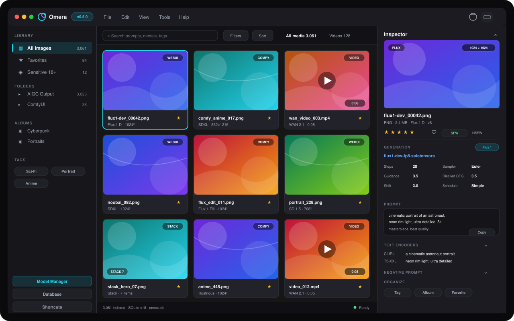
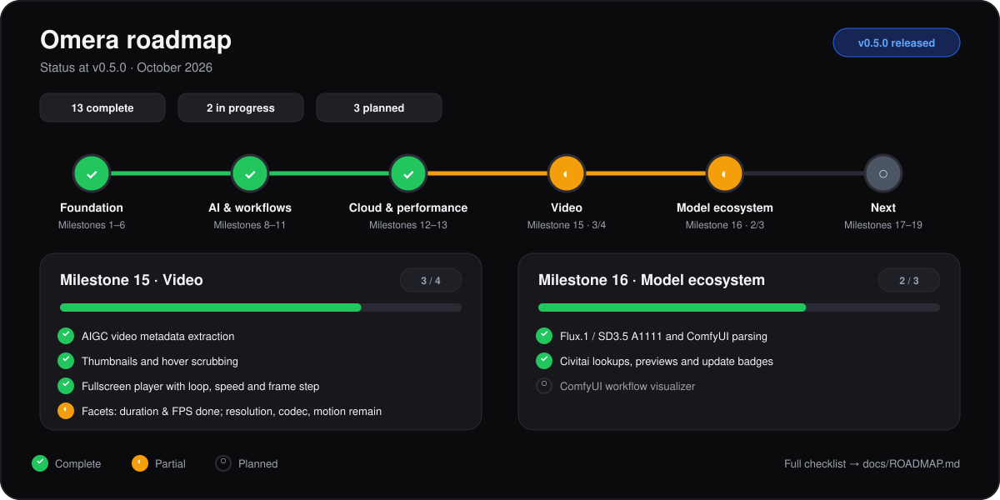

<div align="center">

# 🍇 Omera

**AI画像クリエイターとプロンプトエンジニアのための、オープンソース画像アセット管理＆スタジオ環境**

数万枚規模のAIGCアートワークをミリ秒単位で高速検索、スマート整理、並列比較、一括エクスポート —— すべてがローカルデスクトップ上で快適に動作します。

<br/>

**[English](README.md)** | **[简体中文](README.zh-CN.md)** | **[繁體中文](README.zh-TW.md)** | **[日本語](README.ja.md)**

<br/>

<a href="https://github.com/BerryUIKI/Omera/stargazers"></a>&nbsp;&nbsp;
<a href="https://github.com/BerryUIKI/Omera/network/members"></a>&nbsp;&nbsp;
<a href="https://github.com/BerryUIKI/Omera/issues"></a>

<br/>

[](https://github.com/BerryUIKI/Omera/releases/latest)
[](https://github.com/BerryUIKI/Omera/releases)
[](LICENSE)
[](https://berryuiki.github.io/Omera/)

[](https://tauri.app)
[](https://www.rust-lang.org)
[](https://vuejs.org)
[](#-ダウンロード)

<br/>

<picture>
  <source media="(prefers-color-scheme: dark)" srcset="docs/screenshots/gui_preview_dark.svg">
  <source media="(prefers-color-scheme: light)" srcset="docs/screenshots/gui_preview_light.svg">
  
</picture>

</div>

<br/>

## 🚀 クイックスタート

1. **ダウンロード** — **[GitHub Releases 公式リリース](https://github.com/BerryUIKI/Omera/releases/latest)** からお使いのOS向けインストーラーを入手します。
2. **初回設定** — アプリの言語とデータベースの保存先を選択します。検出された Berry ライブラリを確認してからインポートし、再起動して検証済みスナップショットを有効にします。任意のクリーンアップには別途確認が必要です。
3. **フォルダ追加** — WebUI、ComfyUI、または NovelAI の出力先フォルダを指定します。*外部リンクモード*（コピー不要のインプレース参照）または *AIGCパイプラインモード*（バックグラウンド自動収集）を選択できます。
4. **ブラウズ＆制作** — ライブラリは一瞬で検索可能になります。評価、タグ付け、並列比較、メタデータを保持したエクスポートをストレスフリーに行えます。

---

## 🆕 v0.5.0 の新機能

> **Flux.1 / SD3.5 パラメータ解析、Civitai 直接連携、0.5.0 署名済みインストーラー** — [変更履歴の全文を見る →](CHANGELOG.md)

- 🧬 **Flux.1 / SD3.5 パラメータ解析** — A1111/Forge と ComfyUI のメタデータから Guidance、Distilled CFG Scale、Shift、スケジュールタイプ、CLIP-L / T5-XXL デュアルテキストエンコーダープロンプトを抽出。
- 🔎 **Civitai 直接検索** — AutoV2/SHA256 で Checkpoint と LoRA を逆引きし、プレビューカードをローカルキャッシュ、新バージョンを表示し、学習済みトリガーワードをローカル LoRA カタログへ統合。
- 🛡️ **署名済みリリース** — v0.5.0 は Windows、macOS、Linux の署名済みインストーラーと対応する `.minisig` を提供。
- 🎨 **より明確な生成パラメータ** — インスペクターが 7 言語すべてで新しい Flux/SD3.5 フィールドとデュアルテキストエンコーダープロンプトを表示。

---

## ✨ 主な機能

### 🎨 3ペインスタジオ UI

- **ネイティブ品質のフレームレスウィンドウ** — 統合メニューバー（`ファイル`、`編集`、`表示`、`ツール`、`ヘルプ`）、ドラッグ領域、ウィンドウコントロールを備えたタイトルバー。
- **左側ナビゲーションサイドバー** — メディアライブラリ（すべての画像、お気に入り、センシティブ 18+）、リアルタイムスキャン表示付きフォルダ階層ツリー、カラータグ、スマートアルバム。
- **中央ギャラリー — グリッド · ウォーターフォール · リスト** — 数万枚の画像を滑らかに描画する仮想スクロール、Masonry ウォーターフォールレイアウト、スムーズなサムネイル拡大スライダー（130 px – 360 px）、⊞ / ▦ / ☰ ワンクリック切り替え。
- **レスポンシブな固定幅カラム** — ウィンドウリサイズ時にカードを横に引き伸ばさず、カラム数を動的に増減させて最適な密度を維持。
- **右側プロパティインスペクター** — 大画面プレビューカード、`0〜5` スター評価、お気に入り切り替え、トークン化プロンプトチップ＆ワンクリックコピー、LoRA タグ、生成パラメータ表示、折りたたみ式ワークフローJSONビューア。
- **全画面クイックルック (ライトボックス)** — スペースキー（`Space`）または Enter で即座に全画面表示。マウスホイール拡大縮小、パン移動、キーボード送り対応。

### 🔍 ロスレスな AIGC メタデータ解析エンジン

プロンプト、ネガティブプロンプト、モデル名、ハッシュ、サンプラー、ステップ数、CFG、シード値、サイズ、完全なワークフローJSONを自動抽出：

| 生成ツール | 解析対象 |
|:---|:---|
| **AUTOMATIC1111 / SD.Next** | PNG `tEXt`/`iTXt` parameters チャンク、WebP EXIF |
| **ComfyUI** | 完全な Prompt および Workflow JSON グラフ構文解析、LoRA ローダーの自動検出 |
| **NovelAI** | Comment および Description 署名解析 |
| **Fooocus / Fooocus-MRE** | パラメータおよびベースモデル解析 |
| **InvokeAI & EasyDiffusion** | 埋め込みメタデータおよび JSON サイドカーファイル |
| **Flux.1 / SD3.5** | A1111/Forge Guidance フィールド、ComfyUI デュアルエンコーダープロンプト |
| **サイドカーファイル** | `.txt` 同名テキストファイル |

**対応フォーマット：** PNG · JPG/JPEG · WebP · AVIF · MP4 動画 · WebM 動画

### 🎬 動画・アニメーション対応

- **AIGC 動画メタデータ** — MP4/WebM コンテナ内の ComfyUI AnimateDiff、Wan2.1、HunyuanVideo、CogVideoX、LTX-Video、SVD ワークフローを解析。
- **ホバースクラブ** — グリッドとウォーターフォールのカード上で動画フレームを直接スクラブ。
- **全画面プレーヤー** — ループ、0.25x–2x 再生速度、コマ送り（`.` / `,`）、ミュート、共有インスペクター。
- **動画ファセット** — 再生時間、フレームレート（FPS）、メディアタイプで絞り込み。解像度、コンテナコーデック、motion score は計画中。

### 🗃️ マルチモード取り込み＆スマートスタッキング

- **外部リンクモード (External Link)** — ファイルを移動せずインプレース参照、ディスク容量ゼロ消費。
- **管理ボルトモード (Managed Vault)** — アプリ専用のストレージ領域。
- **AIGC パイプラインモード (Pipeline)** — WebUI/ComfyUI の出力フォルダを自動監視し、デバウンス収集。
- **インテリジェント連写スタック** — 類似プロンプトと生成時刻から連写画像を自動グルーピング。
- **インタラクティブなスタックカード** — トランプデッキ風カード表示、枚数バッジ、インライン展開/折りたたみ、カバー指定（`Alt+S`）、左右並列比較モード（`C`）、安全なスタック統合。

### 🧠 ローカル AI インテリジェンス

- **ローカル CLIP / SigLIP セマンティック検索** — ローカル ONNX モデルにより、自然言語の文章で画像を直感検索。クラウド不要。
- **WD14 / Danbooru アニメ自動タグ付け** — アニメ・リアル系画像のタグ自動抽出、信頼度閾値の調整に対応。
- **類似画像逆引き検索** — 構図や色合いが似ている画像を素早くピックアップ。
- **LoRA トリガーワードライブラリ** — LoRA ディレクトリをスキャンし、Civitai の学習済みトリガーワード・説明・プレビューを統合、ワンクリックで注入。
- **プロンプト頻度分析** — プロンプト内のキーワード出現頻度と平均評価を統計分析。
- **モデルマネージャー** — AutoV2/SHA256 による Civitai 直接検索、プレビューカードのキャッシュ、バージョン更新バッジ、ワンクリックモデル絞り込み。

### ☁️ クラウド同期＆エクスポート

- **S3 / WebDAV スナップショットバックアップ** — AWS S3、Cloudflare R2、MinIO、Backblaze B2、WebDAV サーバへのホット `VACUUM INTO` バックアップ。スキーマ検証とロールバック保護付き。
- **差分リモートメディアミラーリング（単方向アップロード）** — S3、WebDAV、NAS への単方向メディアアップロード。ファイルサイズと SHA-256 差分検知、トークンバケット帯域制限、Dry-Run シミュレーション、アトミックキャンセルに対応。リモートからのプル、ETag キャッシュ検証、双方向同期は計画中です。
- **マルチスレッド一括トランスコード** — WebP/JPEG/PNG への並列変換、4段階のメタデータ消去ポリシー、カスタムファイル命名テンプレート。
- **スタンドアロン HTML Showcase 生成** — 単体で動く `index.html` を出力。Webサーバーを立てずにダークテーマギャラリー、ライトボックス、プロンプト表示付きポートフォリオを共有可能。

### 👥 マルチデータベースチームスタジオ（計画中）

- **現在のランタイム：SQLite** — 高速なローカルデータベース、WAL モードでシングルユーザーおよびネットワークファイルシステムシナリオに対応。
- **ストレージエンジン抽象化** — マルチバックエンドサポート向けに設計された `StorageEngine` トレイトと方言システム。MySQL 8.0+ と PostgreSQL 14+ バックエンドは実験的/計画中の機能です。
- **クロスプラットフォームストレージルート** — Windows、macOS、Linux 間のネットワークマウントパスを自動正規化。
- **SQL エクスポートと接続テスト** — SQLite データを移行用にエクスポート；リモート接続文字列のテスト（ライブクエリバックエンドの実装は計画中の機能）。

### 🌐 多言語＆自動アップデート

- **7言語ネイティブ対応** — 日本語 · 英語 · 簡体字中国語 · 繁体字中国語 · ドイツ語 · フランス語 · スペイン語
- **OS言語の自動検出** — システムの言語設定に自動追従（`Auto`）。
- **ビルトインアップデート確認** — **ヘルプ > アップデートを確認…** からワンクリックで最新リリースノート確認とインストーラー入手が可能。

---

## ⚡ 圧倒的なパフォーマンス

Omera は大規模ライブラリ向けに設計されています。起動時はインデックス済みローカル SQLite から即座に描画し、ファイル走査による起動の引っかかりを完全に排除しています：

| 計測指標 | 1,000 枚 | 10,000 枚 | 50,000 枚 |
|:---|:---:|:---:|:---:|
| 初回描画時間（ウォームキャッシュDB） | **4.48 ms** | **23.65 ms** | **143.55 ms** |
| スクロール急激操作時のメインスレッド長時間ブロック (> 50 ms) | **0 回** | **0 回** | **0 回** |
| サムネイルマニフェスト読み込み完了時間 | — | — | **3.26 秒** (15,300 件/秒) |

**設計アーキテクチャの強み：**

- **O(1) キーセットカーソルページネーション** — 50万件規模でも 1ms 未満でページ送り（従来の `OFFSET` より84倍高速）。
- **フレーム統合レンダリング** — `requestAnimationFrame` あたり最大1回のリアクティブ更新に制限。
- **カラム別二分探索ウォーターフォール** — 画面内表示アイテムを二分探索で瞬時に計算し、全データ走査を回避。
- **需要駆動型サムネイルパイプライン** — 画面内カードを最優先でデコードし、スクロール停止後に投機的先読みを開始。
- **ディレクトリフィンガープリント** — 親ディレクトリの `mtime` 検証により、再スキャン時にローカルで 2.5倍、ネットワークドライブで 5.6倍の高速化。

📖 詳細は [パフォーマンス設計とベンチマーク報告書](docs/PERFORMANCE.md) をご覧ください。

---

## 🏗️ アーキテクチャ

```
┌─────────────────────────────────────────────────────────────────┐
│                   Omera (デスクトップ)                │
├─────────────────────────────────────────────────────────────────┤
│  Vue 3 + TypeScript          │  Tauri 2 IPC コマンドレイヤー    │
│  ─ 仮想グリッド / ウォーター │  ─ 薄型アダプター、入力検証、    │
│    フォール                  │    ロック早期解放                │
│  ─ インスペクター / ライト   │  ─ 50以上のエンドポイント        │
│    ボックス / 37コンポーネント│                                 │
├──────────────────────────────┼──────────────────────────────────┤
│             モジュール型 Rust Cargo ワークスペース               │
│  ┌──────────────┐ ┌──────────────┐ ┌───────────────┐           │
│  │ berry-domain │ │berry-metadata│ │  berry-scan   │           │
│  │ 純粋モデル   │ │ PNG/EXIF/    │ │ スキャナー、  │           │
│  │ ゼロ I/O 契約│ │ ComfyUI/     │ │ サムネイル、  │           │
│  │              │ │ NovelAI/...  │ │ Showcase 生成 │           │
│  └──────────────┘ └──────────────┘ └───────────────┘           │
│  ┌──────────────┐ ┌──────────────┐ ┌───────────────┐           │
│  │berry-storage │ │ berry-tagger │ │  berry-clip   │           │
│  │ SQLite       │ │ WD14 ONNX    │ │ CLIP/SigLIP   │           │
│  │ (ランタイム) │ │ Danbooru     │ │ テキスト＆画像│           │
│  │ マイグレー   │ │ タグ自動抽出 │ │ マルチモーダル│           │
│  │ ション       │ │              │ │ 埋め込み      │           │
│  └──────────────┘ └──────────────┘ └───────────────┘           │
└─────────────────────────────────────────────────────────────────┘
```

**使用技術スタック：** Tauri 2 · Rust (2021 edition) · Vue 3.5 · TypeScript 5.6 · Vite 6 · SQLite (WAL) · Rayon · ONNX Runtime

---

## ⌨️ 主なショートカットキー

| ショートカット | 機能 | ショートカット | 機能 |
|:---|:---|:---|:---|
| `Space` / `Enter` | 全画面ライトボックスの開閉 | `0` – `5` | スター評価を設定 (0 で解除) |
| `F` | お気に入りの切り替え | `B` | 左側サイドバーの表示/非表示 |
| `I` | 右側インスペクターの表示/非表示 | `/` または `Ctrl+F` | 検索バーにフォーカス |
| `Ctrl+A` | すべての画像を選択 | `Esc` | 選択解除 / ダイアログを閉じる |
| `Ctrl+O` | フォルダ作成ウィザード | `Ctrl+,` | 設定画面を開く |
| `Ctrl+G` | 手動スタック / スタック統合 | `Ctrl+Shift+G` | スタック解除 / 全画像展開 |
| `Alt+S` | 現在の画像をスタックカバーに設定 | `C` | 左右並列比較モード |
| `Delete` | 選択した画像をゴミ箱へ移動 | `?` | ショートカット一覧を表示 |

---

## 📥 ダウンロード

最新のビルド済みバイナリは **[GitHub Releases 公式ページ](https://github.com/BerryUIKI/Omera/releases/latest)** より入手可能です：

| OS プラットフォーム | アーキテクチャ | 形式 | 配布ファイル名 |
|:---|:---|:---|:---|
| **Windows** | x86_64 (64-bit) | NSIS インストーラー | `Omera_Windows_x64.exe` |
| **Windows** | x86_64 (64-bit) | ポータブル Zip | `Omera_Windows_x64.zip` |
| **macOS** | Apple Silicon (ARM64) | DMG ディスクイメージ | `Omera_macOS_aarch64.dmg` |
| **macOS** | Intel (x86_64) | DMG ディスクイメージ | `Omera_macOS_x64.dmg` |
| **Linux** | x86_64 (64-bit) | AppImage | `Omera_Linux_x64.AppImage` |
| **Linux** | x86_64 (64-bit) | Debian パッケージ | `Omera_Linux_x64.deb` |

---

## 🛠️ ソースコードからのビルド

### 必要環境

- **Node.js** v18+ および **pnpm** — `npm install -g pnpm`
- **Rust** 1.75+ — [rustup.rs](https://rustup.rs/) からインストール
- **ビルドツール** — Windows (MSVC Build Tools), macOS (Xcode CLI), Linux (`libwebkit2gtk-4.1`)

### ビルド手順

```bash
# 1. リポジトリをクローン
git clone https://github.com/BerryUIKI/Omera.git
cd Omera

# 2. フロントエンド依存関係のインストール
pnpm install

# 3. 開発モードの起動 (ホットリロード)
pnpm run tauri dev

# 4. リリース用バイナリのビルド
pnpm run tauri build
```

出力バイナリ：`src-tauri/target/release/bundle/`

---

## 🗺️ ロードマップ

<picture>
  <source media="(prefers-color-scheme: dark)" srcset="docs/screenshots/roadmap_status_dark.svg">
  <source media="(prefers-color-scheme: light)" srcset="docs/screenshots/roadmap_status_light.svg">
  
</picture>

**Milestone 15（動画）** と **Milestone 16（Flux.1 / SD3.5 + Civitai）** は一部完了しています。残りは解像度/コーデック/motion score ファセットと ComfyUI ワークフロー可視化です。Milestone 17–20 は ComfyUI リアルタイムワークフロー、LAN Web コンパニオン、カラー分析、画像圧縮を対象とします。

📖 詳細は [docs/ROADMAP.md](docs/ROADMAP.md) をご覧ください。

---

## 🤝 コントリビューション

バグ報告、機能要望、新しいメタデータ抽出器の追加、翻訳の改善など、あらゆる貢献を歓迎します！

1. リポジトリをフォークし、`dev` ブランチから作業用ブランチを作成してください（`main` への直接コミットはお控えください）。
2. [コントリビューションガイド](CONTRIBUTING.md) と [コーディング規約](AGENTS.md) をご確認ください。
3. プルリクエストを送信する前に、以下のコマンドがすべてパスすることを確認してください：

```bash
pnpm run build          # フロントエンドビルド
pnpm run test:stack     # スタック動作テスト
cargo clippy --workspace -- -D warnings
cargo test --workspace  # Rust バックエンドテスト
```

---

## 📄 ライセンス

本プロジェクトは **[Apache-2.0 ライセンス](LICENSE)** のもとで公開されています。

Copyright © 2026 [BerryUIKI](https://github.com/BerryUIKI).

---

## 🙏 謝辞

Omera は、以下の優れたオープンソースプロジェクトの恩恵を受けて開発されています：

- [Tauri](https://tauri.app) — 超軽量クロスプラットフォームデスクトップアプリフレームワーク
- [Vue.js](https://vuejs.org) — プログレッシブ JavaScript フレームワーク
- [Rust](https://www.rust-lang.org) & [Rayon](https://github.com/rayon-rs/rayon) — 高性能かつ安全な並行処理言語
- [rusqlite](https://github.com/rusqlite/rusqlite) — エルゴノミックな SQLite バインディング
- [ONNX Runtime](https://onnxruntime.ai) — クロスプラットフォーム機械学習推論エンジン
- [CLIP](https://github.com/openai/CLIP) & [SigLIP](https://arxiv.org/abs/2303.15343) — マルチモーダルビジョン・ランゲージモデル
- [WD14 Tagger](https://huggingface.co/SmilingWolf) — 高精度アニメ画像自動分類モデル

---

<div align="center">

**[⬆ トップへ戻る](#-omera)**

Omera がお役に立ちましたら、ぜひ ⭐ をお願いします！プロジェクトの認知向上につながります。

<a href="https://star-history.com/#BerryUIKI/Omera&Date">
  <picture>
    <source media="(prefers-color-scheme: dark)" srcset="https://api.star-history.com/svg?repos=BerryUIKI/Omera&type=Date&theme=dark" />
    <source media="(prefers-color-scheme: light)" srcset="https://api.star-history.com/svg?repos=BerryUIKI/Omera&type=Date" />
    
  </picture>
</a>

<sub>Made with ❤️ by the Omera community</sub>

</div>
