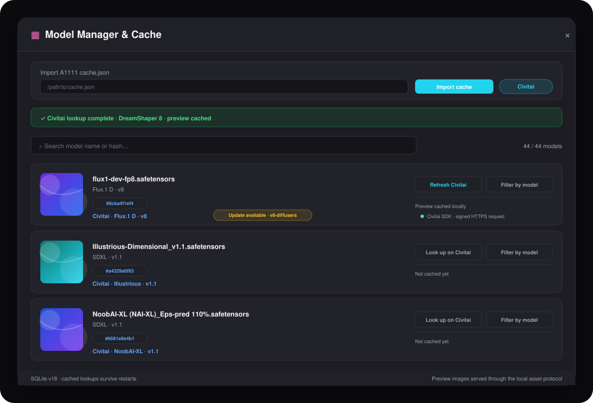
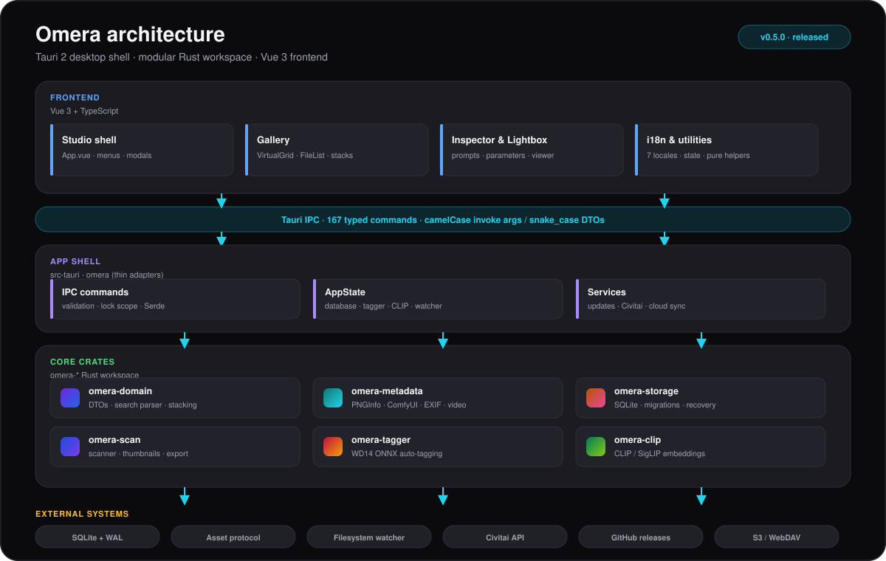

<div align="center">

# 🍇 Omera

**專為 AI 圖像創作者與 Prompt 工程師打造的開源資產管理與提示詞工作台**

毫秒級檢索、智慧整理、雙圖對比與批次匯出數以萬計的 AIGC 藝術作品 —— 一切都在極致流暢的本機桌面端完成。

<br/>

**[English](README.md)** | **[简体中文](README.zh-CN.md)** | **[繁體中文](README.zh-TW.md)** | **[日本語](README.ja.md)**

<br/>

<a href="https://github.com/BerryUIKI/Omera/stargazers"></a>&nbsp;&nbsp;
<a href="https://github.com/BerryUIKI/Omera/network/members"></a>&nbsp;&nbsp;
<a href="https://github.com/BerryUIKI/Omera/issues"></a>

<br/>

[](https://github.com/BerryUIKI/Omera/releases/latest)
[](https://github.com/BerryUIKI/Omera/releases)
[](LICENSE)
[](https://berryuiki.github.io/Omera/)

[](https://tauri.app)
[](https://www.rust-lang.org)
[](https://vuejs.org)
[](#-下載安裝)

<br/>

<picture>
  <source media="(prefers-color-scheme: dark)" srcset="docs/screenshots/gui_preview_dark.svg">
  <source media="(prefers-color-scheme: light)" srcset="docs/screenshots/gui_preview_light.svg">
  
</picture>

</div>

<br/>

## 🚀 快速上手

1. **下載安裝** — 前往 **[GitHub Releases 官方發佈頁面](https://github.com/BerryUIKI/Omera/releases/latest)** 下載相應作業系統的安裝檔。
2. **首次設定** — 選擇應用程式語言和資料庫目錄。檢查找到的 Berry 媒體庫後再匯入，重新啟動後啟用已驗證的快照。清理為選用，並需另行確認。
3. **加入目錄** — 將 Omera 指向您的 WebUI、ComfyUI 或 NovelAI 輸出目錄。選擇 *外鏈模式*（零拷貝就地引用）或 *AIGC 管線模式*（背景防抖自動收割）。
4. **瀏覽與創作** — 您的海量圖庫已即時完成索引。打星評分、打標管理、多圖對比、分詞提取與無損匯出皆在指尖。

---

## 🆕 v0.5.0 重大更新

> **Flux.1 / SD3.5 參數解析、Civitai 直連整合與 0.5.0 簽章安裝檔** — [閱讀完整更新日誌 →](CHANGELOG.md)

- 🧬 **Flux.1 / SD3.5 參數解析** — 從 A1111/Forge 與 ComfyUI 元數據中提取 Guidance、Distilled CFG Scale、Shift、排程類型以及 CLIP-L / T5-XXL 雙文字編碼器提示詞。
- 🔎 **Civitai 直連查詢** — 透過 AutoV2/SHA256 反查 Checkpoint 與 LoRA、本機快取預覽卡、標記新版本，並將訓練觸發詞合併到本機 LoRA 詞庫。
- 🛡️ **簽章發佈** — v0.5.0 提供 Windows、macOS 與 Linux 簽章安裝檔及對應 `.minisig` 檔案。
- 🎨 **更清晰的生成參數** — 檢查器在全部 7 種語言中展示新增的 Flux/SD3.5 欄位與雙文字編碼器提示詞。

---

## ✨ 核心特色

### 🎨 沉浸式三欄現代工作台

- **原生質感無邊框視窗** — 精緻自訂標題列，整合桌面原生選單列（`檔案`、`編輯`、`檢視`、`工具`、`說明`）、視窗拖曳區與精緻控制按鈕。
- **左側階層導覽列** — 媒體庫快捷入口（全部圖片、我的最愛、敏感內容 18+ 分級）、即時掃描狀態回饋的資料夾目錄樹、彩色標籤庫與智慧相簿。
- **中央畫廊 — 網格 · 瀑布流 · 清單** — 支援毫秒級渲染數萬張圖像的虛擬捲動體系，Masonry 瀑布流自適應版面配置、平滑縮圖縮放滑桿（130 px – 360 px），以及 ⊞ / ▦ / ☰ 一鍵切換。
- **自適應穩定欄寬** — 視窗縮放時不拉伸變形卡片，透過動態增減欄數保持視覺密度一致。
- **右側屬性檢查器** — 大圖預覽卡片、`0~5` 星級盲打評分、收藏切換、分詞高亮標籤與一鍵複製、辨識 LoRA 標籤、生成參數展台及原始 JSON 工作流程折疊檢視器。
- **全螢幕沉浸燈箱 (Quick Look)** — 按空白鍵（`Space`）或 Enter 瞬間呼叫，支援滾輪平滑縮放、拖曳平移與鍵盤切圖。

### 🔍 全平台 AIGC 元數據無損解析

自動提取並索引正向提示詞、反向提示詞、模型名稱、雜湊、取樣器、步數、CFG、Seed、解析度與完整工作流程 JSON：

| 生成平台 | 解析來源 |
|:---|:---|
| **AUTOMATIC1111 / SD.Next** | PNG `tEXt`/`iTXt` parameters 區塊、WebP EXIF |
| **ComfyUI** | 完整 Prompt 與 Workflow 節點圖 JSON、LoRA 載入器辨識 |
| **NovelAI** | Comment 與 Description 簽名格式解碼 |
| **Fooocus / Fooocus-MRE** | 專有參數解析與基底模型提取 |
| **InvokeAI & EasyDiffusion** | 內嵌元數據與 JSON Sidecar 伴生檔案 |
| **Flux.1 / SD3.5** | A1111/Forge Guidance 欄位、ComfyUI 雙文字編碼器提示詞 |
| **Sidecar 伴生文字** | `.txt` 伴生同名元數據文字檔 |

**支援的檔案容器：** PNG · JPG/JPEG · WebP · AVIF · MP4 影片 · WebM 影片

### 🎬 影片與動畫支援

- **AIGC 影片元數據** — 解析 MP4/WebM 容器中的 ComfyUI AnimateDiff、Wan2.1、HunyuanVideo、CogVideoX、LTX-Video 與 SVD 工作流程。
- **懸浮擦洗** — 在網格與瀑布流卡片上直接拖曳瀏覽影片畫格。
- **全螢幕播放器** — 循環、0.25x–2x 倍速、逐畫格步進（`.` / `,`）、靜音，並重用共享檢查器。
- **影片篩選** — 依時長、影格率（FPS）與媒體類型篩選；解析度、容器編碼與 motion score 篩選仍在規劃中。

### 🗃️ 多模式匯入與智慧連拍堆疊

- **外鏈模式 (External Link)** — 就地索引，零磁碟拷貝佔用。
- **託管保險庫模式 (Managed Vault)** — 專用應用程式內部儲存空間。
- **AIGC 管線模式 (Pipeline)** — 自動監聽 WebUI/ComfyUI 輸出目錄並防抖收割入庫。
- **智慧連拍堆疊** — 基於提示詞相似度與時間窗口，自動聚合相似迭代版本。
- **互動疊放卡片** — 撲克牌疊放視覺卡片，具數量徽章、行內展開/折疊、設定封面圖（`Alt+S`）、雙圖並排對比（`C`）以及安全交易性合併展開。

### 🧠 本機 AI 智慧引擎

- **本機 CLIP / SigLIP 語意搜尋** — 純本機 ONNX 模型驅動，無需連網即可用自然語言搜尋圖像。
- **WD14 / Danbooru 動漫自動標註** — 自動反推動漫及寫實風格標籤，支援信賴度閾值調整。
- **以圖搜圖視覺相似度檢索** — 快速尋找風格、構圖相似的畫面。
- **LoRA 觸發詞庫與 Civitai 同步** — 掃描 LoRA 模型目錄、合併 Civitai 訓練觸發詞/描述/預覽，並一鍵複製注入觸發詞。
- **提示詞詞頻與表現洞察** — 正負提示詞關鍵字頻率統計，關聯平均評分表現。
- **模型庫管理與雜湊反查** — 透過 AutoV2/SHA256 直連 Civitai 查詢、快取預覽卡、顯示版本更新徽章，並支援一鍵模型篩選。

<picture>
  <source media="(prefers-color-scheme: dark)" srcset="docs/screenshots/gui_model_manager_dark.svg">
  <source media="(prefers-color-scheme: light)" srcset="docs/screenshots/gui_model_manager_light.svg">
  
</picture>

<sub>示意介面 · Civitai 查詢、預覽快取與版本更新徽章</sub>

### ☁️ 雲端同步與匯出工具

- **S3 / WebDAV 快照備份** — 熱 `VACUUM INTO` 備份至 AWS S3、Cloudflare R2、MinIO、Backblaze B2 與各類 WebDAV 伺服器，具備結構驗證與安全復原保障。
- **增量式遠端媒體鏡像（單向上傳）** — 支援單向媒體上傳至 S3、WebDAV 及本機/NAS 目錄，具備檔案大小與 SHA-256 異動偵測、權杖桶頻寬限制、Dry-Run 模擬與不可部分完成取消；遠端拉取對齊、ETag 快取核驗與雙向同步規劃中。
- **多執行緒批次格式轉碼** — 快速將圖片平行轉碼為 WebP/JPEG/PNG，提供 4 級隱私去識別化與自訂檔案命名範本。
- **單一 HTML Showcase 產生器** — 匯出獨立運行的 `index.html`，無需任何 Web 服務即可向客戶展示具深色主題、燈箱與提示詞面板的作品集。

### 👥 多資料庫團隊協作工作室（規劃中）

- **目前執行階段：SQLite** — 快速本機資料庫，採用 WAL 模式支援單一使用者及網路檔案系統情境。
- **儲存引擎抽象層** — `StorageEngine` 特性與方言系統設計為支援多後端。MySQL 8.0+ 與 PostgreSQL 14+ 後端為實驗性/規劃中功能。
- **跨平台儲存根路徑映射** — 針對 Windows、macOS 與 Linux 異構網路掛載點自動規範化相對路徑。
- **SQL 匯出與連線測試** — 匯出 SQLite 資料用於移轉；測試遠端連線字串（即時查詢後端的實作為規劃中功能）。

### 🌐 國際化與自動檢查更新

- **7 種原生語言** — 繁體中文 · 簡體中文 · English · 日本語 · Deutsch · Français · Español
- **作業系統語言自適應** — 預設跟隨系統語言（`Auto`）。
- **內建檢查更新** — 在 **說明 > 檢查更新…** 中即刻取得最新版本說明與官方下載連結。

---

## ⚡ 卓越效能

Omera 為十萬級海量圖庫專門設計。應用程式啟動時直接渲染 SQLite 本機索引庫，絕不讓檔案目錄走訪阻塞首屏渲染：

| 評估指標 | 1,000 張圖像 | 10,000 張圖像 | 50,000 張圖像 |
|:---|:---:|:---:|:---:|
| 首屏可用畫廊渲染時間（熱資料庫） | **4.48 ms** | **23.65 ms** | **143.55 ms** |
| 極速拖曳捲軸時主執行緒長任務 (> 50 ms) | **0 次** | **0 次** | **0 次** |
| 縮圖持久化資訊清單載入耗時 | — | — | **3.26 s** (15,300 檔案/秒) |

**底層架構保障：**

- **O(1) 鍵集游標分頁** — 50 萬張圖片深度換頁僅需 < 1ms（較傳統 `OFFSET` 提速 84 倍）。
- **畫面合併渲染排程** — 每次 `requestAnimationFrame` 最多只觸發一次響應式重繪。
- **按欄二分搜尋瀑布流** — 毫秒級計算視埠內可見項目，避免全量資料集走訪。
- **按需驅動縮圖管線** — 僅優先解碼視埠可見卡片，捲動靜止後才啟動預先載入。
- **目錄指紋攔截機制** — 父目錄 `mtime` 比對機制在二次掃描時本機提速 2.5 倍，網路儲存提速 5.6 倍。

📖 詳見 [效能架構設計與基準測試報告](docs/PERFORMANCE.md)。

---

## 🏗️ 架構分層

<picture>
  <source media="(prefers-color-scheme: dark)" srcset="docs/screenshots/architecture_dark.svg">
  <source media="(prefers-color-scheme: light)" srcset="docs/screenshots/architecture_light.svg">
  
</picture>

**核心技術棧：** Tauri 2 · Rust (2021 edition) · Vue 3.5 · TypeScript 5.6 · Vite 6 · SQLite (WAL) · Rayon · ONNX Runtime

---

## ⌨️ 常用快速鍵

| 快速鍵 | 功能說明 | 快速鍵 | 功能說明 |
|:---|:---|:---|:---|
| `Space` / `Enter` | 開啟 / 關閉全螢幕燈箱 | `0` – `5` | 設定星級評分 (0 為清除) |
| `F` | 切換我的最愛 | `B` | 顯示 / 隱藏左側導覽列 |
| `I` | 顯示 / 隱藏屬性檢查器 | `/` 或 `Ctrl+F` | 聚焦頂部搜尋列 |
| `Ctrl+A` | 全選目前全部圖像 | `Esc` | 取消選取 / 關閉彈跳視窗或燈箱 |
| `Ctrl+O` | 開啟資料夾建立精靈 | `Ctrl+,` | 偏好設定與設定 |
| `Ctrl+G` | 手動疊放 / 合併成堆 | `Ctrl+Shift+G` | 解除疊放 / 展開全部圖像 |
| `Alt+S` | 設定目前圖像為封面 | `C` | 雙圖並排對比模式 |
| `Delete` | 將選取圖片移至資源回收筒 | `?` | 呼出快速鍵指南 |

---

## 📥 下載安裝

前往 **[GitHub Releases 官方發佈頁面](https://github.com/BerryUIKI/Omera/releases/latest)** 下載最新預先編譯安裝檔：

| 作業系統平台 | 處理器架構 | 格式類型 | 安裝檔檔案名稱 |
|:---|:---|:---|:---|
| **Windows** | x86_64 | NSIS 安裝檔 | `Omera_<version>_x64-setup.exe` |
| **Windows** | x86_64 | MSI | `Omera_<version>_x64_en-US.msi` |
| **macOS** | Apple Silicon (arm64) | DMG 磁碟映像 | `Omera_<version>_aarch64.dmg` |
| **Linux** | x86_64 | AppImage | `Omera_<version>_amd64.AppImage` |
| **Linux** | x86_64 | Debian 套件 | `Omera_<version>_amd64.deb` |
| **Linux** | x86_64 | RPM | `Omera-<version>-1.x86_64.rpm` |

目前發佈矩陣涵蓋 Windows x64、macOS Apple Silicon 與 Linux x64；不發佈 Intel macOS 與可攜 ZIP。

---

## 🛠️ 原始碼建置指南

### 環境準備

- **Node.js** v18+ 與 **pnpm** — `npm install -g pnpm`
- **Rust** 1.75+ — 推薦透過 [rustup.rs](https://rustup.rs/) 安裝
- **編譯工具鏈** — Windows 為 MSVC Build Tools，macOS 為 Xcode CLI，Linux 為 `libwebkit2gtk-4.1`

### 建置步驟

```bash
# 1. 複製程式碼倉庫
git clone https://github.com/BerryUIKI/Omera.git
cd Omera

# 2. 安裝前端相依套件
pnpm install

# 3. 執行本機開發模式（支援熱重載）
pnpm dev:desktop

# 4. 打包正式版安裝程式
pnpm tauri build
```

編譯輸出目錄：`src-tauri/target/release/bundle/`

---

## 🗺️ 開發路線圖

<picture>
  <source media="(prefers-color-scheme: dark)" srcset="docs/screenshots/roadmap_status_dark.svg">
  <source media="(prefers-color-scheme: light)" srcset="docs/screenshots/roadmap_status_light.svg">
  
</picture>

**Milestone 15（影片）** 與 **Milestone 16（Flux.1 / SD3.5 + Civitai）** 已部分完成；剩餘項目為解析度/編碼/motion score 篩選與 ComfyUI 工作流程視覺化。Milestone 20（圖片壓縮）已交付；Milestone 17–19 涵蓋 ComfyUI 即時工作流程、區域網路 Web 伴侶與色彩分析。

📖 查閱完整開發計畫：[docs/ROADMAP.md](docs/ROADMAP.md)。

---

## 🤝 參與貢獻

我們熱烈歡迎各類 Issue 回報、功能建議、新元數據解析器適配以及多語言翻譯！

1. Fork 本倉庫並從 `dev` 分支建立您的特性分支（請勿直接向 `main` 提交）。
2. 請閱讀 [貢獻指南](CONTRIBUTING.md) 與 [代碼規範指引](AGENTS.md)。
3. 在提交 Pull Request 前請確保以下驗證指令全部通過：

```bash
pnpm run build          # 前端 TypeScript 校驗與建置
pnpm run test:stack     # 堆疊與畫廊邏輯測試
cargo clippy --workspace -- -D warnings
cargo test --workspace  # Rust 後端單元測試
```

---

## 📄 開源授權

本專案基於 **[Apache-2.0 開源協議](LICENSE)** 發布。

Copyright © 2026 [BerryUIKI](https://github.com/BerryUIKI).

---

## 🙏 特別致謝

Omera 的誕生離不開以下優秀的開源專案：

- [Tauri](https://tauri.app) — 超輕量跨平台桌面應用程式開發框架
- [Vue.js](https://vuejs.org) — 漸進式前端 JavaScript 框架
- [Rust](https://www.rust-lang.org) & [Rayon](https://github.com/rayon-rs/rayon) — 兼具高效能與並發安全的原生語言
- [rusqlite](https://github.com/rusqlite/rusqlite) — 優雅好用的 SQLite 綁定
- [ONNX Runtime](https://onnxruntime.ai) — 跨平台機器學習高效能推論引擎
- [CLIP](https://github.com/openai/CLIP) & [SigLIP](https://arxiv.org/abs/2303.15343) — 多模態視覺-語言大模型
- [WD14 Tagger](https://huggingface.co/SmilingWolf) — 動漫領域高品質反推打標模型

---

<div align="center">

**[⬆ 返回頂部](#-omera)**

如果您覺得 Omera 對您的創作有所幫助，請為我們點亮一顆 ⭐，這能讓更多創作者發現這個專案！

<a href="https://star-history.com/#BerryUIKI/Omera&Date">
  <picture>
    <source media="(prefers-color-scheme: dark)" srcset="https://api.star-history.com/svg?repos=BerryUIKI/Omera&type=Date&theme=dark" />
    <source media="(prefers-color-scheme: light)" srcset="https://api.star-history.com/svg?repos=BerryUIKI/Omera&type=Date" />
    
  </picture>
</a>

<sub>Made with ❤️ by the Omera community</sub>

</div>
