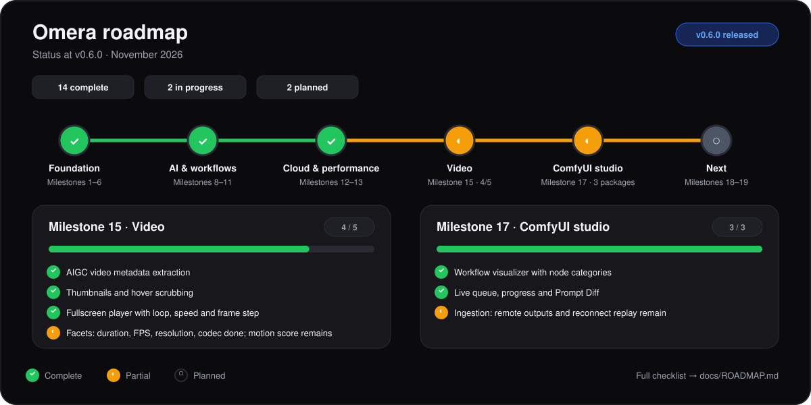

# 🗺️ Omera Roadmap

This roadmap documents completed milestones and future engineering goals for **Omera**.

<picture>
  <source media="(prefers-color-scheme: dark)" srcset="screenshots/roadmap_status_dark.svg">
  <source media="(prefers-color-scheme: light)" srcset="screenshots/roadmap_status_light.svg">
  
</picture>

---

## 🏆 Completed Milestones (v0.1.0 & v0.1.1)

### ✅ Milestone 1: Core Foundation & Scaffolding
- [x] Multi-crate Rust workspace architecture (`omera-domain`, `omera-metadata`, `omera-scan`, `omera-storage`, `src-tauri`).
- [x] Embedded SQLite engine with `PRAGMA user_version` incremental migrations.
- [x] Cross-platform build configurations for Windows, macOS, and Linux.

### ✅ Milestone 2: Scanning & Indexing Engine
- [x] Multi-threaded recursive folder scanner with support for `PNG`, `JPG`/`JPEG`, `WebP`, `MP4`, and `.txt` sidecars.
- [x] Incremental indexing based on `(size_bytes, modified_at)` fingerprinting.
- [x] Real-time scanning progress event streaming to frontend.

### ✅ Milestone 3: Eagle-Style Studio Workspace & Browsing
- [x] Custom frameless desktop window with integrated menu bar (`File`, `Edit`, `View`, `Tools`, `Help`).
- [x] Collapsible 3-Pane Studio Layout (Left Sidebar + Center Canvas + Right Inspector).
- [x] High-performance virtualized grid view (`VirtualGrid.vue`) supporting tens of thousands of images.
- [x] Dynamic thumbnail zoom slider (130px–360px) and Table / Grid view switcher.
- [x] Fullscreen Quick Look Lightbox (`LightboxModal.vue`) with mouse-wheel zoom and keyboard navigation.

### ✅ Milestone 4: Comprehensive AIGC Metadata Parsers
- [x] **WebUI (AUTOMATIC1111 / SD.Next)**: PNG `parameters` chunk and WebP EXIF.
- [x] **ComfyUI**: Full Prompt and Workflow JSON graph syntax parsing.
- [x] **NovelAI**: Comment and Description signature parser.
- [x] **Fooocus & Fooocus-MRE**: Parameter parsing and base model resolution.
- [x] **InvokeAI & EasyDiffusion**: Embedded metadata & JSON sidecars.
- [x] Platform badge display standardization (`WebUI`, `ComfyUI`, `NovelAI`, `Fooocus`, `InvokeAI`, `SD`).

### ✅ Milestone 5: Organization, Search & Prompt Insights
- [x] Free-form search query parser supporting structured key-value tokens, quotes, and ranges.
- [x] Visual search filter drawer (`FilterDrawer.vue`).
- [x] Smart Albums and color-coded Tag taxonomy with drag-and-drop support.
- [x] Floating batch actions toolbar (`BatchActionBar.vue`).
- [x] Prompt keyword frequency & rating correlation analysis (`PromptStatsModal.vue`).
- [x] Checkpoint Model Manager with Civitai SHA256 cache import & hash reverse lookup (`ModelManagerModal.vue`).
- [x] Sensitive content (NSFW 18+) privacy protection with blur overlay and click-to-reveal.

### ✅ Milestone 6: Maintenance, Updates & Localization
- [x] SQLite database maintenance tools: live `VACUUM` compaction, backup export, and one-click restoration.
- [x] GitHub Releases auto-updater (`UpdateModal.vue`) with SemVer comparison and multi-state feedback.
- [x] Reactive i18n localization covering 7 languages (`en`, `zh-CN`, `zh-TW`, `ja`, `de`, `fr`, `es`) with OS auto-tracking.
- [x] Multilingual documentation and standardized release packaging naming `<AppName>_<OS>_<Architecture>.<extension>`.

---

## 🏆 Completed Milestones (v0.2.0)

### ✅ Milestone 8: AI-Assisted Tagging & Local CLIP Semantic Search
- [x] Persistent image embedding storage (schema v7 `file_embeddings`) and high-performance local cosine similarity ranking.
- [x] Visual similarity search (find similar compositions & styles) with real-time threshold slider and configurable result limits.
- [x] Local WD14 / Danbooru ONNX tagger for automated anime & realistic tag extraction with confidence filtering and batch tagging.
- [x] Local CLIP / SigLIP vision & text embedding pipeline with tokenization and batch library indexing dashboard (`ClipManagerModal.vue`).
- [x] Free-form natural language text-to-image semantic search toggle directly integrated into the search bar.

### ✅ Milestone 9: Advanced Generation Workflows & LoRA Catalog
- [x] LoRA trigger word library with Civitai info extraction and automatic prompt copy injection (`LoraManagerModal.vue`).
- [x] Full ComfyUI workflow node graph reconstruction and LoRA loader detection.
- [x] Detected LoRA chips in Inspector pane with one-click trigger injection.

### ✅ Milestone 10: Multi-Mode Folders, AIGC Ingest Pipeline & Image Stacking
- [x] **Multi-Mode Folder Architecture**:
  - Mode A: External Link mode (reference in-place, zero-copy, read-only watch).
  - Mode B: Managed Project Vaults (dedicated storage with drag-and-drop Copy/Move ingestion).
  - Mode C: AIGC Ingestion Pipeline (monitors WebUI / ComfyUI outputs, debounced harvest, and delayed recycle bin cleanup).
- [x] **WebUI & ComfyUI Autodetection & Onboarding Wizard**:
  - Heuristic auto-scan for local A1111/ComfyUI/Fooocus output directories.
  - Interactive First-Run Onboarding Wizard for instant setup.
  - Folder Creation Mode Wizard modal (`AddFolderModal.vue`).
- [x] **AIGC Image Stacking & Gallery Engine**:
  - Auto-stacking based on prompt similarity threshold and generation time window.
  - Discoverable scan-and-organize actions for the current folder or the full library, with localized progress and result feedback.
  - Empty-prompt safeguards, prompt-weight normalization, and folder/model boundaries for higher-quality automatic groups.
  - Manual grouping (`Ctrl+G`), unstacking (`Ctrl+Shift+G`), and hero cover selection (`Alt+S`).
  - Poker deck visual cards with badge counts, inline expand/collapse, and side-by-side compare mode (`C`).
  - Flat stack merge safety with warning confirmation dialog and suppressible settings.
  - Filter-aware stack counts, heroes, and expansion across navigation, structured, text, and semantic result contexts.
  - Virtualized Waterfall gallery layout mode alongside standard grid.

---

### ✅ Milestone 11: Generation Interop & Workflows
- [x] Drag-and-drop workflow transfer and send-to-WebUI / send-to-ComfyUI via local HTTP API backend proxy.
- [x] One-click batch cull (automatically keep hero/top-rated images and move drafts to system Trash with review modal).
- [x] Configurable ComfyUI and SD WebUI endpoints with real-time connectivity testing.

---

## 🏆 Completed Milestones (v0.3.0)

### ✅ Milestone 12: Cloud Sync & Export Utilities
- [x] **Milestone 12.1: Batch Transcoding, Privacy Stripping & Packaging**: Multi-threaded format conversion (WebP/JPEG/PNG), 4-tier privacy metadata stripping, downscaling constraints, customizable filename templates, sidecars (.txt/.json), and Directory / ZIP archive export.
- [x] **Milestone 12.2: Standalone Interactive HTML Showcase Generator**: Self-contained zero-dependency HTML+CSS+JS photo album export with responsive gallery, lightbox preview, and prompt metadata viewer.
- [x] **Milestone 12.3: S3 & WebDAV Snapshot Cloud Backup & Restore**: Automated and manual snapshots of SQLite database and configurations to AWS S3, Cloudflare R2, MinIO, or WebDAV servers.
- [x] **Milestone 12.4: Incremental Remote Asset Mirroring & Delta Sync**: ETag / SHA-256 incremental media sync with background concurrency and bandwidth throttling.

### ✅ Milestone 13: Large-Library Performance
- [x] Fixed-width responsive Grid and Waterfall columns.
- [x] Animation-frame scroll coalescing and per-column Waterfall visibility search.
- [x] Deduplicated, serialized thumbnail look-ahead scheduling.
- [x] Startup scan cooldown with opt-in scanning for new installations.
- [x] Bounded incremental gallery queries with exact totals and stale-response protection.
- [x] Replace offset traversal with keyset cursors if deep-page benchmarks require it.
- [x] Persistent filesystem watcher journal with targeted path reconciliation and optional recovery scans.
- [x] Persistent size-tiered thumbnail manifest with configurable LRU disk budget.
- [x] Cancelable viewport generations with visible-first and directional look-ahead priority.
- [x] Zoom-aware thumbnail tier selection for Gallery and Table surfaces.
- [x] Reuse sufficient cached tiers and prune broken manifest paths during lookup.
- [x] Per-job thumbnail queue diagnostics.
- [x] Coalesce filesystem scan progress events by file count and elapsed time.
- [x] Stream full-scan directory entries without retaining the complete tree.
- [x] Benchmark directory fingerprint strategies on local and network filesystems.
- [x] Lazy-load infrequent modals and drawers through async component boundaries.
- [x] Remove raw metadata blobs from paginated gallery IPC and fetch full details on selection.
- [x] Keep navigation filters and stack grouping aligned across paginated text and semantic searches.
- [x] Benchmark a dedicated gallery DTO for the remaining structured metadata fields.

### Deferred: Multi-Database Support & Team Studio (MySQL & PostgreSQL)

**Correction:** The runtime is SQLite. The historical checklist below records prototype work, not working end-to-end MySQL/PostgreSQL support. Remote backends remain unavailable pending command routing, transactions, migrations and integration tests (issue #110).
*(See architectural design specification: [MULTI_DATABASE_COLLABORATION_RFC.md](./MULTI_DATABASE_COLLABORATION_RFC.md))*
- [x] Storage Engine trait abstraction with database dialect support for SQLite, MySQL 8.0+, and PostgreSQL 14+.
- [x] Keyset/cursor-based deep pagination for 500,000+ asset scale (`search_files_cursor_page`).
- [x] Cross-platform storage root mapping (`storage_roots` table and client mount configurations).
- [x] Optimistic concurrency control (`version` column) with Last-Write-Wins and set-union conflict resolution.
- [x] Tiered real-time change synchronization: default zero-DevOps change log journal polling engine (`CollaborationSyncEngine`).
- [x] Client-side on-demand local thumbnail caching preserving network storage bandwidth.
- [x] Team & Database settings panel with live latency testing and storage root mount mapping.

---

## 🚀 Current & Upcoming Milestones (post-0.6.0)

Status reconciled 2026-11-04: [v0.6.0](https://github.com/BerryUIKI/Omera/releases/tag/v0.6.0)
is published with workflow viewing, live queue monitoring and Prompt Diff.
Release asset inventory and remaining native gates are recorded in
[SIGNED_UPDATES.md](SIGNED_UPDATES.md). The current bounded implementation package
is opt-in completion-driven indexing of an explicitly selected local output folder.

### Priority: Omera identity and review fixes

Execution order and ownership: [DELIVERY_ROADMAP.md](DELIVERY_ROADMAP.md) and [ENGINEERING_HANDOFF.md](ENGINEERING_HANDOFF.md). High-impact migration, persistence and release work stays with the lead; ordinary UI, parser and bounded performance tasks are prepared for general implementation engineers.

- [x] Complete [OMERA_MIGRATION.md](OMERA_MIGRATION.md): full identity rename, pre-1.0 legacy discovery, staged migration, and separately confirmed cleanup. R0–R6 are complete and [#134](https://github.com/BerryUIKI/Omera/issues/134) is closed. The remaining obligation is standing pre-1.0 compatibility: every release before 1.0.0 keeps legacy discovery and supported import, and cleanup stays a separate explicit user decision.
- [ ] Validate signed updates and platform installer transitions, including skipped bridge releases. [v0.6.0](https://github.com/BerryUIKI/Omera/releases/tag/v0.6.0) is published with signed assets, so the installed-update matrix in [#256](https://github.com/BerryUIKI/Omera/issues/256) is now executable against two consecutive signed stable releases (v0.5.2 → v0.6.0). It remains open until installed-to-next-version acceptance is recorded per platform.
- [x] Complete review issues #98–#117 with regression coverage. All twenty issues are closed as completed and their regression suites run in CI.
- [ ] Measure and implement [STORAGE_EVOLUTION.md](STORAGE_EVOLUTION.md) without rewriting applied migrations. Baseline benchmarks currently cover gallery pagination and directory fingerprinting only; filtering, full-text search and sidebar aggregation still need p50/p95 measurements before any schema or index change.

### 🟡 Milestone 15: Video & Animation AIGC Ingestion & Playback (4 of 5 complete; motion score pending)

Delivered in the v0.4.x line, with the resolution and codec facets following in v0.6.x. The remaining facet work is limited to motion score.

- [x] **AIGC Video Metadata Extraction**: Parse embedded generation workflows and prompts from MP4 and WebM video containers (ComfyUI AnimateDiff, Wan2.1, HunyuanVideo, CogVideoX, LTX-Video, and Stable Video Diffusion).
- [x] **Video Thumbnail Generation & Hover Scrubbing**: Capture frame thumbnails and scrub through video frames while hovering cards in Grid and Waterfall views.
- [x] **Fullscreen Lightbox Video Player**: Seamless loop toggle, playback speed selector (0.25x–2x), frame-by-frame stepping (`.` / `,`), audio toggle, and sidecar prompt/workflow inspection.
- [x] **Duration, Frame-Rate, Resolution & Codec Facets**: Filter videos by duration range, frame rate, pixel width/height and video codec, with an Images/Videos media-type filter. Codec matching folds case so sidecars and older records still match, and the drawer offers SD / HD / FHD+ / 4K+ resolution presets.
- [ ] **Motion Score Facet**: The remaining video filter. [MOTION_SCORE_DESIGN.md](MOTION_SCORE_DESIGN.md) settles the algorithm (downsampled grayscale mean absolute difference over sampled frames), the storage shape (a nullable indexed `files.motion_score` column via a v19 migration) and the compute trigger (opportunistic on the existing WebView decode path plus an explicit batch action). Nothing is implemented yet, and the milestone stays open until the scoring pass is validated against the codec matrix.

### ✅ Milestone 16: Next-Gen Model Architectures & Ecosystem (complete)

Flux.1 / SD3.5 parsing and Civitai integration shipped in v0.5.0. The interactive workflow graph shipped in v0.6.0; see [COMFY_STUDIO.md](COMFY_STUDIO.md) for bounds and acceptance evidence.

- [x] **Flux.1 & SD3.5 Parameter Parsers**: Parse Guidance Scale, Distilled CFG Scale, Shift, schedule type, and dual CLIP-L / T5-XXL text-encoder prompts (ComfyUI). A1111 `Size` continues to supply the resolution bucket dimensions.
- [x] **Civitai Direct API Integration**: Remote model reverse lookups by AutoV2/SHA256, cached preview cards, version update badges, and one-click merge of trained trigger words into the local LoRA catalog.
- [x] **ComfyUI Workflow Visualizer Enhancements**: On-demand interactive workflow graph viewer with prompt, sampler, ControlNet and LoRA categories, selection, search, keyboard navigation, connected-edge highlighting and pan/zoom.

### 🟡 Milestone 17: Bi-Directional ComfyUI Studio, Live Queue & Prompt Diff (3 of 3 complete; pipeline depth pending)
- [x] **Real-Time ComfyUI WebSocket Monitor**: Explicit native HTTP/WebSocket connection, reconnect and bounded queue/history reconciliation; node progress, queue order, outcomes and VRAM in the studio, with status bar and Activity summaries. Qualified with local protocol fixtures only.
- [x] **Completion-Driven Ingestion (first package)**: Opt-in loopback completion events index a registered linked output folder or copy named outputs through an enabled copy-only pipeline, preserving sources and sidecars. See [COMFY_STUDIO.md](COMFY_STUDIO.md).
  - Still pending: remote output transfer, reconnect history replay (outputs missed while disconnected), video/custom-node output descriptors, move pipelines and cleanup, and queue-worker isolation.
- [x] **Prompt Diff & Matrix Workbench**: Select A/B images in comparison mode; compare positive/negative and optional dual text-encoder prompts, explicit weights `(keyword:1.2)`, seeds, models, samplers and other generation parameters. Full details load on demand; long text has bounded section fallback and display limits.

### 🎯 Milestone 18: Local LAN Web Companion (Omera Remote)
- [ ] **Embedded Lightweight HTTP Web Server**: Built-in Axum/Tokio web server in Tauri backend for local network access with secure PIN/passcode authentication.
- [ ] **Responsive Mobile/Tablet Web Companion**: Mobile-optimized touch UI allowing wireless browsing, rating, tagging, favoriting, and prompt copying on iPad, tablets, and smartphones on the same Wi-Fi network.
- [ ] **Live Bi-Directional State Sync**: Rating, tag, and favorite mutations applied on mobile devices immediately synchronize back to the desktop application in real time.

### 🎯 Milestone 19: Color Palette Indexing & Faceted SQL Analytics
- [ ] **Dominant Color Extraction & Palette Indexing**: Multi-threaded extraction of 5-color palettes per asset using k-means/octree quantization, indexing hex colors and lightness into `file_colors` table.
- [ ] **Color Palette Visual Filter Bar**: Interactive hue ribbon and tone picker in search drawer to filter images by dominant color family (Red, Amber, Emerald, Cyan, Violet, Monochrome, Warm, Cool).
- [ ] **Pre-Computed SQL Facet Distribution**: Migrate expensive filter aggregations (models, samplers, ratings, aspect ratio buckets) to materialized views and cached facet counters for instant multi-facet filter rendering on 100k+ item libraries.

### ✅ Milestone 20: Library Image Compression and Conversion (delivered)

Scope, order, safety gates and handoff: [IMAGE_TRANSFORM_PLAN.md](IMAGE_TRANSFORM_PLAN.md) and [DELIVERY_ROADMAP.md](DELIVERY_ROADMAP.md), Phase 6. The Omera-native follow-up to [#118](https://github.com/BerryUIKI/Omera/issues/118) is delivered; AVIF remains export-only until a cross-platform decoder is packaged.

- [x] [#158](https://github.com/BerryUIKI/Omera/issues/158): Fix current export codec/extension, quality, metadata and collision/result correctness; retain directory and ZIP compatibility.
- [x] Add export preview, size estimate and explicit per-file outcomes.
- [x] [#159](https://github.com/BerryUIKI/Omera/issues/159): Add optional compression/conversion while importing into managed storage, retaining external originals by default.
- [x] [#160](https://github.com/BerryUIKI/Omera/issues/160): Add verified post-import batch transformation for managed assets with keep/archive/system-Trash choices and recovery.
- [x] Evaluate target-size, percentage resize and alignment controls after measuring quality and processing cost.

